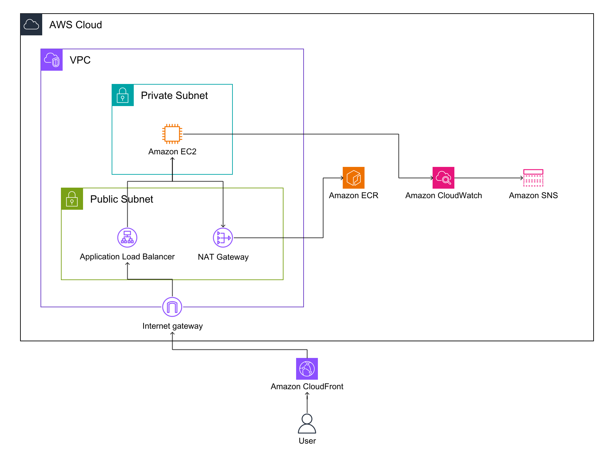
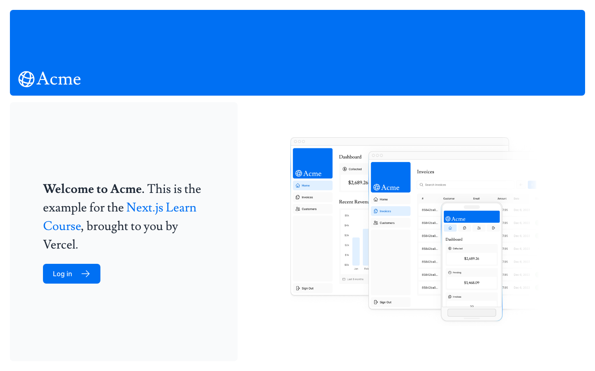
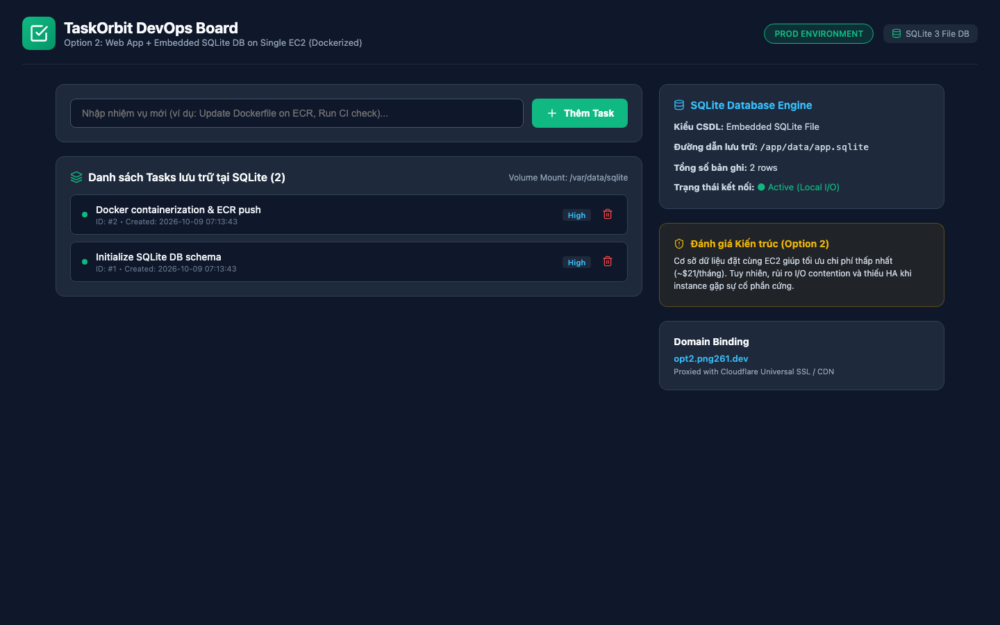

# Option 2: Web Application + Local DB on Single EC2

Independent infrastructure and application source code for **Option 2: Web Application + Local Persistent DB on Single EC2 with Amazon CloudFront Edge Caching**.

## 1. Architecture Overview

### Key Architectural Highlights:
- **CloudFront CDN Edge Caching:** Caches static assets (`/_next/static/*`) globally, reducing direct request pressure on the single EC2 server to preserve CPU/RAM for the co-located local database.
- **Application Load Balancer (ALB):** Spans Multi-AZ Public Subnets, handling SSL/TLS termination and forwarding traffic to the private EC2 instance.
- **Single EC2 Web + Local Database:** Runs the Dockerized Next.js application alongside a local SQLite database mounted onto an encrypted EBS gp3 volume (`/var/data/sqlite`).
- **AWS SSM Container Reload:** CI/CD triggers zero-SSH remote container updates via `aws ssm send-command`, pulling the latest image without opening inbound port 22.
- **Automated Monitoring & Alerts:** CloudWatch Alarms (ALB 5XX and EC2 CPU > 85%) notify engineers via Amazon SNS Topic; log retention auto-expires after 14 days (Dev) / 30 days (Prod).
- **AWS-Native Custom Domain:** Directs user traffic via DNS CNAME (DNS-only) directly to Amazon CloudFront Edge & ALB endpoints.

## 2. Cost Analysis

### A. Cost by Purchasing Option (t3.medium 4GB RAM Recommended for Web + DB)
| Purchasing Model | EC2 Compute | Supporting Components (IP + 50GB EBS + Backup) | Total Monthly Cost | Approx. Local Currency (VND) |
| :--- | :--- | :--- | :--- | :--- |
| **On-Demand (Default)** | $30.37 / mo | $9.15 / mo | **$39.52 / mo** | ~998,000 VND |
| **1-Year Savings Plan (1-Yr Commitment)** | $19.13 / mo | $9.15 / mo | **$28.28 / mo** *(28% savings)* | ~714,000 VND |
| **3-Year Savings Plan (3-Yr Commitment)** | $12.13 / mo | $9.15 / mo | **$21.28 / mo** *(46% savings)* | ~537,000 VND |
| **Spot Instance (Dev/Test Only)** | $9.07 / mo | $9.15 / mo | **$18.22 / mo** *(Not recommended for stateful DB)* | ~460,000 VND |

## 3. Disaster Recovery & Recovery Time (MTTR)

Tested and verified under real AWS Chaos Engineering scenarios:

| Failure Scenario | Recovery Mechanism | Measured Recovery Time (MTTR) | Data Integrity / Impact |
| :--- | :--- | :--- | :--- |
| **Container Process Crash (`docker kill`)** | Systemd watchdog unit auto-restart | **7 seconds** | 100% data intact; uptime reset 66,270s → 5.7s |
| **Sudden Hard OS Reboot (`reboot -f`)** | EBS gp3 auto-remount + SQLite WAL recovery | **16 seconds** | 100% data integrity verified (0 data loss) |
| **SQLite I/O Performance** | Better-sqlite3 WAL transaction on EBS gp3 | **3ms** per 1,000 writes | 0.003ms/row write; 0.004ms/query read |
| **Target Response Latency** | CloudWatch ALB Metrics | **8.8ms average** | Fast local SQLite response time |

## 4. Application Screenshots

| Development Environment (`opt2-dev.png261.dev`) | Production Environment (`opt2.png261.dev`) |
| :---: | :---: |
|  |  |
